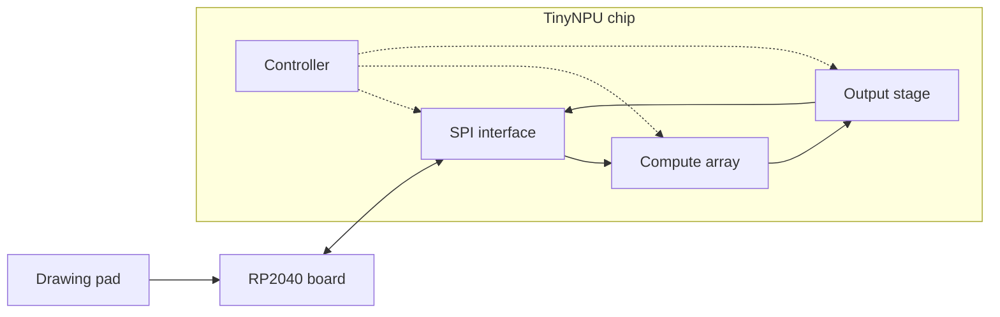

# TinyNPU

TinyNPU is a small chip that speeds up the math behind neural networks. The heart of the project is the systolic array, a square grid of processing elements. Each processing element holds one 8-bit weight, multiplies it by a passing input, adds the result to a running total, then passes the input to its neighbor. To show it working, we'll run a demo that recognizes handwritten digits between 0 and 9.

To learn more about the project structure, see [Architecture](#architecture).

## Status

| Part | Owner |
|---|---|
| Quantized MNIST model | ML |
| Golden model | Verification |
| PE + systolic array | RTL |
| SPI + control FSM | RTL |
| cocotb testbench | Verification |
| Hardening + timing | Physical design |

## Architecture

### SPI interface

The chip's voice to the outside world. Receives weights and inputs from the RP2040 and sends the results back.

### Controller

Directs when each block is allowed to run. It reads each command from the SPI interface and steps the chip through it: loading weights into the processing elements, feeding inputs into the array at the right time, waiting for the results, and telling the output stage when to capture them. The SPI interface moves the data; the controller decides what to do with it.

### Compute array

The systolic array. Our goal is a 4x4 grid of PEs to compute more efficiently.

### Output stage

"Cleans up" the results of the compute array and sends them back to the SPI interface to be outputted.

### RP2040

The microcontroller that runs the demo. The chip is too small to hold a whole network, so the RP2040 splits each layer into pieces, sends them to the chip one at a time, and puts the results together.

## Repo layout

| Folder | Contents |
|---|---|
| `src/` | Verilog RTL |
| `test/` | cocotb testbenches |
| `golden/` | Bit-exact Python model of the chip. All tests check against it. |
| `model/` | PyTorch training for weights |
| `firmware/` | RP2040 firmware |
| `docs/` | Specs, pinout and meeting notes |

## License

Apache 2.0 (from the Tiny Tapeout template).